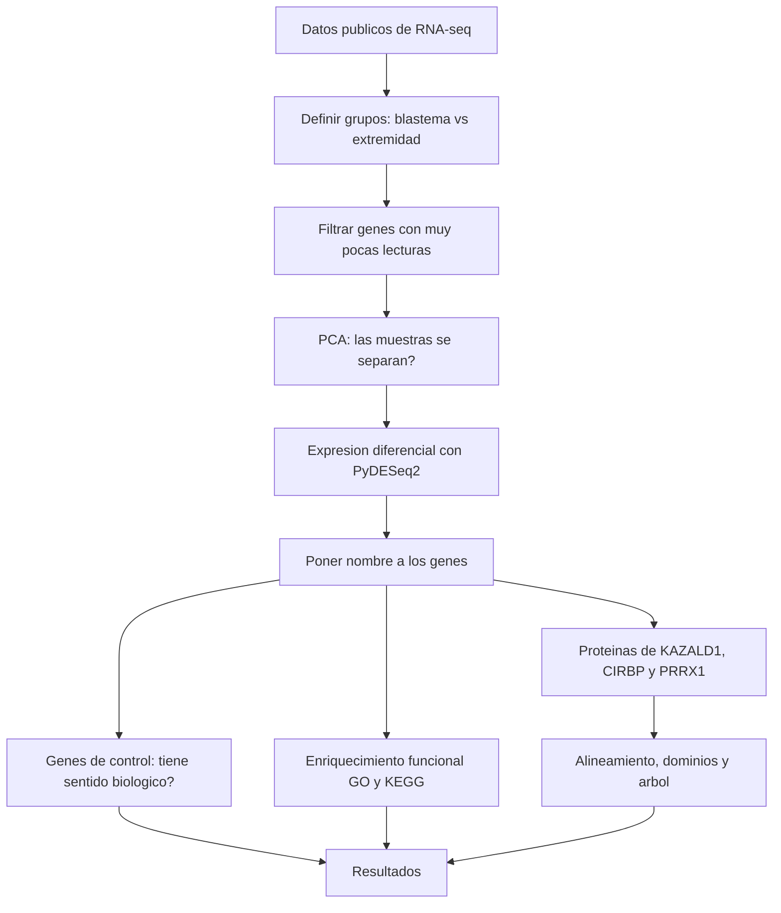

# Flujo bioinformático paso a paso del Cuaderno de Colab

**Regeneración de extremidades en el ajolote (*Ambystoma mexicanum*):**

[

Esta carpeta contiene el cuaderno de Google Colab con todo el análisis y esta guía, que explica **qué se hace en cada paso, por qué se hace y cómo interpretar lo que genera**. 
El objetivo es que cualquier persona que lea la guía pueda entender el análisis completo y explicarlo frente a un póster, incluyendo las preguntas difíciles.

> Para el contexto general del proyecto (hipótesis, objetivos, referencias y enlaces de datos), consulta el `README.md` de la raíz del repositorio.

---

## Contenido

1. [La idea completa ](#1-la-idea-completa-en-un-minuto)
2. [Cómo leer esta guía](#2-cómo-leer-esta-guía)
3. [Paso 0. Preparar el entorno](#paso-0-preparar-el-entorno)
4. [Paso 1. Obtener los datos](#paso-1-obtener-los-datos)
5. [Paso 2. Definir los grupos a comparar](#paso-2-definir-los-grupos-a-comparar)
6. [Paso 3. Filtrar los genes](#paso-3-filtrar-los-genes)
7. [Paso 4. Explorar con un PCA](#paso-4-explorar-con-un-pca)
8. [Paso 5. Expresión diferencial](#paso-5-expresión-diferencial)
9. [Paso 6. Ponerle nombre a los genes](#paso-6-ponerle-nombre-a-los-genes)
10. [Paso 7. Verificar con genes de control](#paso-7-verificar-con-genes-de-control)
11. [Paso 8. Volcano plot y heatmap](#paso-8-volcano-plot-y-heatmap)
12. [Paso 9. Enriquecimiento funcional](#paso-9-enriquecimiento-funcional)
13. [Paso 10. Comparar proteínas entre especies](#paso-10-comparar-proteínas-entre-especies)
14. [Paso 11. Integrar y presentar el póster](#paso-11-integrar-y-presentar-el-póster)
15. [Resultados clave en una tabla](#resultados-clave-en-una-tabla)
16. [Limitaciones, explicadas](#limitaciones-explicadas)
17. [Preguntas frecuentes para la exposición](#preguntas-frecuentes-para-la-exposición)
18. [Guion de 3 minutos](#guion-de-3-minutos)
19. [Preguntas para practicar](#preguntas-para-practicar)
20. [Glosario](#glosario)
21. [Cómo ejecutar el cuaderno](#cómo-ejecutar-el-cuaderno)
22. [Referencias](#referencias)

---

## 1. La idea completa en un minuto

El ajolote puede regenerar una pata completa si la pierde. Justo después de la amputación se forma un **blastema**, un grupo de células jóvenes que reconstruye el miembro. La pregunta es: **¿qué genes están más activos en ese blastema que en una extremidad normal?**

Para responderla no se usan datos que otros científicos ya midieron y publicaron: cuánto RNA produce cada gen en cada muestra. Con ellos se hace lo siguiente:

1. Se comparan **4 muestras de blastema** contra **10 de extremidad intacta**.
2. Se identifican los genes que cambian de forma estadísticamente creíble.
3. Se revisa en qué procesos biológicos participan esos genes.
4. Se toman tres genes (*KAZALD1*, *CIRBP* y *PRRX1*) y se comparan sus proteínas con las de humano, ratón, pez cebra y rana (*Xenopus*) para ver qué tan parecidas son.



| Paso | Pregunta que responde | Herramienta principal | Resultado |
|---|---|---|---|
| 1 | ¿De dónde salen los datos? | `wget` | Tres archivos descargados |
| 2 | ¿Qué comparamos con qué? | pandas | 4 muestras de blastema y 10 de extremidad intacta |
| 3 | ¿Qué genes tienen suficientes datos? | pandas | De 1,388,798 a 37,199 genes |
| 4 | ¿Las muestras se agrupan como esperamos? | PCA | Blastema separado del resto |
| 5 | ¿Qué genes cambian? | PyDESeq2 | 18,896 genes significativos |
| 6 | ¿Qué es cada gen? | UniProt | 13,023 genes con nombre |
| 7 | ¿Los resultados tienen sentido? | revisión manual | *KAZALD1*, *TBX5*, *FGF8*… suben |
| 8 | ¿Cómo se ven los resultados? | matplotlib, seaborn | Volcano y heatmap |
| 9 | ¿Qué procesos están activos? | prueba hipergeométrica | Matriz extracelular y proliferación |
| 10 | ¿Qué tan conservadas están las proteínas? | Biopython, MAFFT | PRRX1 y CIRBP muy conservadas |

---

## 2. Cómo leer esta guía

Cada paso sigue la misma estructura:

- **Qué hacemos:** Metodología
- **Por qué:** el motivo, para poder justificarlo ante cualquier pregunta.
- **Conceptos:** las ideas que hay que dominar.
- **Qué obtuvimos:** los números reales del proyecto.
- **Cómo interpretarlo:** qué significa y qué no.

Se recomienda leerla en orden, porque cada paso usa conceptos del anterior.

---

## Paso 0. Preparar el entorno

**Qué hacemos.** Abrimos el cuaderno en Google Colab e instalamos las librerías necesarias.

**Por qué.** Colab es un servicio gratuito de Google que ejecuta código Python en un servidor remoto desde el navegador. El análisis completo cabe ahí porque no se trabaja con el genoma (que es enorme), sino con tablas de conteos y secuencias cortas de proteínas.

**Conceptos.**

- **Cuaderno (notebook):** un documento organizado en **celdas**. Unas contienen texto y otras contienen código que se ejecuta una por una.
- **Librería:** un paquete de código ya escrito que se importa para no empezar de cero (por ejemplo, `pandas` para manejar tablas).
- **Sesión:** el servidor que Google asigna temporalmente. **Cuando la sesión se cierra o se reinicia, se borran los archivos del almacenamiento temporal** (`/content`). Por eso conviene guardar los resultados importantes en Google Drive o descargarlos.

**Librerías que se usan y para qué sirven:**

| Librería | Función |
|---|---|
| `pandas`, `numpy` | Manejar tablas y cálculos |
| `matplotlib`, `seaborn` | Gráficas |
| `scikit-learn` | PCA |
| `pydeseq2` | Expresión diferencial |
| `scipy`, `statsmodels` | Estadística (prueba hipergeométrica y corrección por pruebas múltiples) |
| `biopython` | Trabajar con secuencias, alineamientos y árboles |
| `requests` | Consultar bases de datos por internet (UniProt, Enrichr) |


---

## Paso 1. Obtener los datos

**Qué hacemos.** Descargamos tres archivos del portal Axolotl-Omics (Broad Institute) con el comando `wget`:

| Archivo | Qué contiene | Tamaño aproximado |
|---|---|---|
| `Axo.rsem.genes.counts.wAnnot.matrix.gz` | Tabla de conteos por gen y por muestra | 20 MB |
| `Axolotl.Trinity.CellReports2017.Trinotate.xls.gz` | Anotación funcional (dominios, homologías) | 28 MB |
| `Axolotl.Trinity.CellReports2017.transdecoder.pep.gz` | Proteínas predichas | 26 MB |

Después comprobamos que no estén dañados con `gzip -t`.

**Por qué.** Estos datos fueron generados por Bryant y colaboradores (2017), que secuenciaron el RNA de 42 muestras de 16 tejidos del ajolote. 
**Conceptos.**

- **RNA-seq.** Técnica para medir qué genes están activos. Se extrae el RNA de un tejido, se convierte a DNA complementario (cDNA) y se secuencia en fragmentos cortos llamados **lecturas (reads)**. Cuantas más lecturas provienen de un gen, más RNA de ese gen había en el tejido, y por tanto más activo estaba.
- **Transcriptoma.** El conjunto de todos los RNA presentes en un tejido en un momento dado.
- **Ensamblaje *de novo*.** El ajolote tiene un genoma muy grande (cerca de 32 mil millones de pares de bases), así que en este estudio no se alinearon las lecturas contra un genoma. En su lugar, un programa llamado **Trinity** reconstruyó los transcritos uniendo lecturas que se solapan, como armar un rompecabezas sin tener la imagen de la caja.
- **Cuantificación con RSEM.** Otro programa estima cuántas lecturas corresponden a cada gen y da **conteos esperados**, que pueden tener decimales.
- **Matriz de conteos.** Una tabla donde cada **fila** es un gen, cada **columna** es una muestra y cada **celda** es el número de lecturas.
- **Archivos `.gz`.** Archivos comprimidos. `gzip -t` verifica que la descarga no se cortó.
- **`wget`.** Comando que descarga un archivo desde un enlace.

**Qué obtuvimos.** Una matriz de **1,388,798 filas por 42 columnas**.

**Cómo interpretarlo.** ¿Por qué tantas filas, si un animal tiene decenas de miles de genes? Porque el ensamblaje *de novo* genera muchos fragmentos y variantes de un mismo transcrito. La mayoría de esas filas son ruido, y por eso el siguiente paso es filtrar.

**Cómo se leen los identificadores** (por ejemplo, `c1076561_g4_i1`): según la convención del ensamblador, `c…_g…` agrupa transcritos que probablemente provienen del mismo gen, e `_i1` indica una variante (isoforma) de ese gen.

**Cómo se leen los nombres de las columnas** (por ejemplo, `distal_GCCAAT_L006`): empiezan con el tejido, seguido de un código que parece identificar la muestra en la secuenciación. Las muestras de blastema (`distal_*` y `proximal_*`) incluyen además una marca de carril del secuenciador (`L006`, `L008`), un detalle que será importante más adelante.

---

## Paso 2. Definir los grupos a comparar

**Qué hacemos.** Elegimos 14 de las 42 muestras y las dividimos en dos grupos:

| Grupo | Muestras | n |
|---|---|---|
| **Blastema** | `distal_*` (2) y `proximal_*` (2) | 4 |
| **Extremidad intacta** | `hand_*` (3), `forearm_*` (2), `elbow_*` (2), `upperarm_*` (3) | 10 |

```python
def grupo(c):
    if c.startswith(("distal_", "proximal_")): return "blastema"
    if c.startswith(("hand_", "forearm_", "elbow_", "upperarm_")): return "extremidad_intacta"
    return None
```

**Por qué.** Una comparación necesita dos condiciones claras. Las otras 28 muestras (corazón, testículo, ovario, embriones, hueso, cartílago, etc.) corresponden a otros tejidos y no responden a nuestra pregunta.

**Conceptos.**

- **Réplica biológica.** Cada muestra independiente del mismo grupo. Las réplicas permiten medir cuánto varía naturalmente un gen entre individuos; sin ellas, no se puede distinguir un cambio real de una variación al azar.
- **Metadatos.** La tabla que dice a qué grupo pertenece cada muestra. Es la "etiqueta" que usa el programa estadístico.
- **Blastema.** Según el artículo, se tomaron blastemas en estadio de **yema media**, derivados de amputaciones proximales (cerca del hombro) y distales (cerca de la muñeca), **retirando antes el epitelio de regeneración**.

**Cómo interpretarlo.** Se agruparon los blastemas proximales y distales porque en el PCA (paso 4) no se separan entre sí, y también se agruparon las cuatro posiciones de la extremidad. Con 4 contra 10 muestras el poder estadístico es limitado, lo cual se declara como limitación.

---

## Paso 3. Filtrar los genes

**Qué hacemos.** Redondeamos los conteos a números enteros y conservamos solo los genes con **al menos 10 lecturas en al menos 4 muestras**.

```python
cnt = df[meta.index].round().astype(int)
cnt = cnt[(cnt >= 10).sum(axis=1) >= 4]
```

**Por qué.** Un gen con 0, 1 o 2 lecturas no aporta información: su "expresión" es indistinguible del ruido. Compararlo entre grupos solo añade pruebas estadísticas inútiles y vuelve más lento el análisis. El umbral de 4 muestras corresponde al tamaño del grupo más pequeño (el blastema): si un gen se expresa solo en el blastema, debería superar el umbral en sus 4 muestras.

**Conceptos.**

- **Ruido:** variación sin significado biológico.
- **Prueba estadística:** cada gen requiere una; con 1.4 millones de genes habría 1.4 millones de pruebas, con muchos falsos positivos (ver paso 5).

**Qué obtuvimos.** De **1,388,798 genes a 37,199**. Dos de las pruebas posteriores descartaron además unos 190 genes que no pudieron evaluarse (quedaron **37,009**).

**Cómo interpretarlo.** El umbral (10 lecturas en 4 muestras) es una decisión razonable pero no la única posible. Otra elección daría listas ligeramente distintas.

---

## Paso 4. Explorar con un PCA

**Qué hacemos.** Normalizamos de forma sencilla los conteos, calculamos un PCA y graficamos cada muestra como un punto.

**Por qué.** Antes de hacer estadística formal conviene mirar los datos. El PCA responde: **¿las muestras del mismo grupo se parecen entre sí y se diferencian del otro?** Si no fuera así, habría que sospechar de un problema en el diseño o en los datos.

**Conceptos.**

- **CPM (cuentas por millón).** Cada conteo se divide entre el total de lecturas de su muestra y se multiplica por un millón. Sirve para comparar muestras que se secuenciaron con distinta profundidad: una muestra con más lecturas totales tendría números más altos solo por eso.
- **Transformación log2.** Se calcula log2(CPM + 1). Evita que unos pocos genes muy expresados dominen el resultado.
- **PCA (análisis de componentes principales).** Cada muestra está descrita por la expresión de decenas de miles de genes, algo imposible de graficar. El PCA encuentra los "ejes" que capturan la mayor parte de la diferencia entre muestras y las proyecta en un plano de dos dimensiones. **Puntos cercanos significan muestras con perfiles de expresión parecidos.** El primer eje (PC1) recoge la mayor variación.

**Qué obtuvimos.** El blastema forma un grupo propio, claramente separado de la extremidad intacta a lo largo de PC1. Los cuatro blastemas (proximales y distales) quedan mezclados entre sí, y las posiciones de la extremidad (mano, antebrazo, codo y brazo) también.

**Cómo interpretarlo.**

- La separación indica que los dos grupos difieren de forma consistente. Esto es lo esperable.
- **Pero una separación tan grande también es lo que produciría un efecto de lote** (*batch effect*): diferencias técnicas debidas a que las muestras se procesaron en momentos o corridas distintas. Las muestras de blastema parecen haberse secuenciado aparte (llevan marca de carril), y condición y lote coinciden por completo, por lo que **no pueden separarse estadísticamente**. Esto no invalida el análisis, pero debe declararse. Los pasos 7 y 9 sirven como comprobación biológica.

---

## Paso 5. Expresión diferencial

**Qué hacemos.** Usamos **PyDESeq2** para comparar, gen por gen, la expresión del blastema contra la de la extremidad intacta.

```python
dds = DeseqDataSet(counts=cnt.T, metadata=meta[["condicion"]], design="~condicion")
dds.deseq2()
st = DeseqStats(dds, contrast=["condicion", "blastema", "extremidad_intacta"])
st.summary()
res = st.results_df.dropna(subset=["padj"])
```

**Por qué.** Mirar a ojo qué genes "parecen" más altos no es suficiente. Hace falta un método estadístico que tome en cuenta cuánto varía cada gen entre réplicas y que controle los falsos positivos.

**Conceptos.**

- **¿Por qué no una prueba t sencilla?** Los datos de RNA-seq son **conteos** (números enteros, no negativos), con pocas réplicas, y su variabilidad depende de cuán expresado esté el gen. Una prueba t supone otro tipo de datos.
- **Normalización por tamaño de biblioteca.** Igual que con el CPM, DESeq2 ajusta cada muestra para que una diferencia en la profundidad de secuenciación no se confunda con diferencia de expresión.
- **Modelo binomial negativo.** Es una distribución estadística adecuada para conteos con más variación de la que predeciría el azar simple (sobredispersión). DESeq2 y PyDESeq2 ajustan este modelo a cada gen.
- **Dispersión.** La medida de cuánto varían las réplicas de un gen. Como hay pocas réplicas, el método "toma prestada" información de todos los genes para estimarla mejor.
- **baseMean.** El promedio de expresión normalizada del gen en todas las muestras. Un gen con baseMean muy bajo tiene resultados poco fiables.
- **log2FoldChange (log2FC).** Cuántas veces cambia la expresión, en escala logarítmica base 2:

| log2FC | Significado |
|---|---|
| 0 | Sin cambio |
| 1 | El doble en blastema |
| 2 | Cuatro veces más |
| −1 | La mitad |
| 10.5 | Aproximadamente 1,400 veces más |

- **Valor p.** La probabilidad de observar una diferencia al menos así de grande si en realidad no hubiera ninguna. Un valor p pequeño sugiere que el cambio no es casualidad.
- **El problema de las pruebas múltiples.** Con 37,009 genes, aun si no hubiera ninguna diferencia real, un umbral de p < 0.05 marcaría por azar unos **1,850 genes** (el 5%). Para evitarlo se usa una corrección.
- **padj (valor p ajustado) y FDR.** El método de Benjamini-Hochberg ajusta los valores p para controlar la **tasa de falsos descubrimientos (FDR)**. Un padj < 0.05 significa, a grandes rasgos, que entre los genes declarados significativos esperamos alrededor de un 5% de falsos positivos.
- **Umbral doble.** Se exige significancia (padj) **y** tamaño de efecto (|log2FC|). Un gen puede ser estadísticamente significativo con un cambio diminuto y poco relevante biológicamente.

**Qué obtuvimos.**

| Criterio | Genes | Arriba en blastema | Abajo en blastema |
|---|---|---|---|
| padj < 0.05 y \|log2FC\| > 1 | **18,896** | 10,642 | 8,254 |
| Estricto: padj < 0.001, \|log2FC\| > 2 y baseMean ≥ 50 | **3,851** | 1,064 | 2,787 |

PyDESeq2 emitió un aviso: el ajuste paramétrico de la curva de dispersión no convergió y se usó una tendencia basada en la media. No es un error grave, pero debe tomarse en cuenta.

**Cómo interpretarlo.** **Que la mitad de los genes cambie es una señal de alerta**, no un descubrimiento. Puede deberse al efecto de lote, a que se compara un tejido pequeño y poco diferenciado contra una extremidad completa con músculo, hueso y piel, o a que el método asume que la mayoría de los genes no cambia. Por eso se usan los umbrales estrictos para las listas finales y se verifica con genes de control.

---

## Paso 6. Ponerle nombre a los genes

**Qué hacemos.** Los genes del ensamblaje solo tienen códigos (`c1076561_g4`). Extraemos de cada ID la proteína más parecida y convertimos su identificador en un símbolo de gen consultando la base de datos UniProt.

Un identificador anotado se ve así:

```
c1076561_g4_i1^sp|Q8BJ66|KAZD1_MOUSE^sp|Q96I82|KAZD1_HUMAN^IGFBP^sigP^Tm1
```

| Fragmento | Significado |
|---|---|
| `c1076561_g4_i1` | Código del transcrito en el ensamblaje |
| `^` | Separador de campos |
| `sp\|Q8BJ66\|KAZD1_MOUSE` | Mejor coincidencia en Swiss-Prot: accesión `Q8BJ66`, proteína KAZD1 de ratón |
| `sp\|Q96I82\|KAZD1_HUMAN` | Otra coincidencia: KAZD1 humana |
| `IGFBP` | Dominio proteico detectado |
| `sigP` | Péptido señal predicho |
| `Tm1` | Un segmento transmembrana predicho |

**Por qué.** Sin nombres no es posible interpretar biológicamente la lista de genes ni usar bases de datos de funciones.

**Conceptos.**

- **BLAST.** Programa que compara una secuencia contra una base de datos y devuelve las más parecidas. El programa Trinotate lo usó para asignar a cada transcrito del ajolote sus "parientes" conocidos en otras especies.
- **UniProt.** La base de datos de proteínas más usada. **Swiss-Prot** (`sp`) contiene entradas revisadas manualmente; **TrEMBL** (`tr`) contiene entradas automáticas, menos confiables.
- **Accesión.** El código único de una entrada de UniProt (por ejemplo, `Q96I82`).
- **API.** Una forma de pedirle datos a una página web desde el código. Al consultar UniProt muchas veces seguidas puede aparecer el error **429 (demasiadas solicitudes)**; el código espera unos segundos y reintenta.
- **Homología.** Similitud debida a un ancestro común.
- **Ortólogos y parálogos.** Dos genes son **ortólogos** si se separaron porque las especies se separaron (por ejemplo, el *CIRBP* humano y el del ajolote). Son **parálogos** si se separaron por una duplicación génica dentro de una misma especie (por ejemplo, *CIRBP* y *RBM3*).

**Qué obtuvimos.** Tras la conversión, **18,576 de las 37,009 filas** tienen símbolo, lo que equivale a **13,023 genes únicos** (cuando varias filas tienen el mismo símbolo se conserva la más significativa).

**Cómo interpretarlo.**

- Casi la mitad de los transcritos no tiene nombre: no se encontró una proteína parecida o son fragmentos.
- **El nombre proviene de la similitud, no de una demostración.** Que una proteína del ajolote se parezca a KAZALD1 humana no prueba que sea su ortólogo. Por eso en el póster se habla de un gen "tipo KAZALD" o "anotado como KAZALD1", y se verifica con análisis adicionales (paso 10).
- Los símbolos vienen de proteínas de varias especies (ratón, pollo, humano), mientras que las bases de funciones son humanas. Algunos genes se pierden por diferencias de nomenclatura.

---

## Paso 7. Verificar con genes de control

**Qué hacemos.** Revisamos genes cuyo comportamiento en el blastema ya se conoce o se espera, para comprobar que el análisis "tiene sentido".

**Por qué.** Un resultado estadístico puede ser técnicamente correcto y biológicamente absurdo. Los controles funcionan como una prueba de cordura: si los genes esperados salen donde deben, aumenta la confianza en el flujo completo.

**Conceptos.**

- **Control positivo:** un gen que sabemos que debería subir (si no sube, algo falló).
- **Un control no es una prueba independiente:** varios genes se eligieron a partir del mismo artículo de donde provienen los datos, así que la verificación es limitada.

**Qué obtuvimos.**

| Gen | log2FC | padj | Lectura |
|---|---|---|---|
| *KAZALD1* (`c1076561_g4`) | 10.5 | 3×10⁻¹¹⁵ | Resultado más fuerte del análisis |
| *TBX5* | 4.5 | 8×10⁻⁴¹ | Gen de desarrollo de la extremidad anterior |
| *HAND2* | 5.9 | 1×10⁻³⁵ | Gen de desarrollo de la extremidad |
| *PRRX1* | 3.6 | 8×10⁻²² | Factor de transcripción con homeodominio |
| *FGF8* | 5.9 | 4×10⁻²⁸ | Señalización del desarrollo |
| *SHH* | 7.6 | 2×10⁻¹⁶ | Señalización del desarrollo |
| *PAX7* | 2.7 | 5×10⁻⁹ | Gen de células progenitoras |
| *FGFR1* | 1.8 | 3×10⁻⁸ | Receptor de FGF |
| *CIRBP* | 1.8 y 0.9 (dos entradas) | 7×10⁻¹¹ y 6×10⁻¹⁶ | Inducido, de magnitud moderada |
| *MMP9* | 0.04 | 0.95 | Sin cambio |
| *SOX2* | 0.5 | 0.26 | No significativo |

**Cómo interpretarlo.** No todos los controles tienen que subir. *MMP9* y *SOX2* no cambiaron y eso se reporta tal cual. *MSX1*, *MSX2* y *LIN28* no aparecieron entre los resultados anotados; **eso no significa que no se expresen**, puede deberse al filtro, a que tengan otro nombre en la anotación o a que estén fragmentados en el ensamblaje.

---

## Paso 8. Volcano plot y heatmap

**Qué hacemos.** Dibujamos dos gráficas para ver los resultados de un vistazo.

### Volcano plot

- **Eje horizontal:** log2FC. A la derecha, genes con más expresión en el blastema; a la izquierda, menos.
- **Eje vertical:** −log10(padj). Cuanto más arriba, más significativo.
- Cada punto es un gen. Los genes interesantes están **arriba y lejos del centro**.
- Las líneas verticales marcan el umbral de |log2FC| = 2. Los puntos rojos son los genes que suben y los azules los que bajan según el criterio estricto.

La forma de "volcán" aparece porque los genes con mayor cambio suelen ser también los más significativos.

### Heatmap

- Cada **fila** es un gen y cada **columna** una muestra.
- El color indica la expresión relativa de ese gen entre las muestras (**z-score**: cuántas desviaciones estándar está por encima o por debajo de su propio promedio). Rojo es más alto que el promedio del gen, y azul más bajo.
- Se agrupan genes con patrones parecidos (dendrograma de la izquierda).

**Cómo interpretarlos.** En el heatmap, las 4 columnas de blastema se ven claramente distintas de las 10 de extremidad. **Atención:** como los genes graficados se eligieron justamente por ser diferenciales, es esperable que separen los grupos; el heatmap **ilustra** los resultados, no los confirma de forma independiente. Además, en el volcano hay genes con cambios extremos (log2FC de ±10 a −15) que, con solo 4 réplicas de blastema, pueden ser poco fiables; conviene priorizar por significancia y nivel de expresión y no solo por el tamaño del cambio.

---

## Paso 9. Enriquecimiento funcional

**Qué hacemos.** Tomamos la lista de genes que suben (570) y la de genes que bajan (1,360) y preguntamos: **¿qué procesos biológicos aparecen más de lo esperado por azar?**

**Por qué.** Leer una lista de cientos de genes uno por uno no es práctico. El enriquecimiento resume la lista en procesos comprensibles.

**Conceptos.**

- **Gene Ontology (GO).** Un catálogo de procesos biológicos, funciones moleculares y componentes celulares, con los genes asignados a cada categoría. Usamos *GO Biological Process 2023* (5,407 categorías).
- **KEGG.** Una base de datos de rutas metabólicas y de señalización. Usamos *KEGG 2021 Human* (320 rutas).
- **Prueba hipergeométrica.** Responde: si elegimos 570 genes al azar de un universo de 13,023, ¿cuántos esperaríamos que pertenezcan a una categoría que tiene 144 genes? La prueba compara ese número esperado con el observado.
- **Universo o fondo.** El conjunto de genes que **pudimos** medir y nombrar (13,023). Es importante usar el universo correcto: si se usara todo el genoma humano, los resultados se inflarían porque se compararía contra genes que ni siquiera se midieron.
- **Corrección por pruebas múltiples.** Como se evalúan miles de categorías, se aplica de nuevo la corrección de Benjamini-Hochberg (padj).
- **Superposición `k/K`.** En las tablas aparece, por ejemplo, `36/144`: de las 144 genes de la categoría presentes en el universo, 36 están en nuestra lista.

**Ejemplo para entenderlo.** Para *Organización de la matriz extracelular*: el universo es N = 13,023, la lista es n = 570 y la categoría tiene K = 144 genes. Por azar se esperarían alrededor de 570 × 144 / 13,023 ≈ **6.3 genes**, pero observamos **36**. Esa diferencia es lo que produce un padj de 4×10⁻¹⁵.

**Qué obtuvimos.**

*Mayor expresión en el blastema:*

| Proceso | Genes | padj |
|---|---|---|
| Organización de la matriz extracelular | 36/144 | 4×10⁻¹⁵ |
| Interacción matriz extracelular-receptor (KEGG) | 18/77 | 5×10⁻⁷ |
| Desarrollo del sistema esquelético | 22/120 | 2×10⁻⁶ |
| Regulación de la migración celular | 40/349 | 3×10⁻⁶ |
| Organización de fibrillas de colágeno | 12/41 | 1×10⁻⁵ |
| Regulación positiva de la proliferación celular | 37/343 | 4×10⁻⁵ |
| Regulación de la vía BMP | 11/62 | 0.001 |
| Vía Wnt no canónica / Wnt | 7/35 y 9/59 | 0.006 y 0.008 |

*Menor expresión en el blastema:* contracción del músculo estriado (22/43, padj 2×10⁻⁸), ensamblaje de miofibrillas, organización del sarcómero, y también respuesta inflamatoria, señalización tipo NOD y necroptosis.

**Cómo interpretarlo.**

- El perfil de los genes que suben (matriz extracelular, migración y proliferación) es coherente con un tejido de células jóvenes que se está reorganizando y creciendo.
- **Wnt y BMP** salen enriquecidos, pero con significancia moderada comparada con la matriz extracelular. Preséntalos como "también enriquecidos", no como protagonistas. **FGF, Notch y Hedgehog no se detectaron entre los términos principales:** no se debe afirmar que estén enriquecidos.
- **Muchos términos comparten los mismos genes** (por ejemplo, "organización de la matriz extracelular" y "organización de la estructura extracelular"). Hay que contarlos como un solo tema, no como procesos distintos.
- **Los genes que bajan son sobre todo de músculo.** Hay dos explicaciones posibles y los datos no las separan: (1) la extremidad intacta contiene mucho músculo y el blastema no, así que es una diferencia de **composición del tejido**; (2) el blastema podría estar reprimiendo activamente un programa muscular, como plantea el estudio original. No se debe presentar como "la regeneración apaga la contracción muscular".

---

## Paso 10. Comparar proteínas entre especies

Esta parte responde otra pregunta: **¿cambió la secuencia de las proteínas del ajolote respecto a animales que no regeneran?** Se estudian tres genes.

### 10.1 ¿Por qué proteínas y por qué estos tres genes?

- Se comparan **proteínas** y no DNA porque las proteínas usan un alfabeto de 20 aminoácidos y cambian más lentamente, lo que permite comparar especies lejanas.
- ***KAZALD1***: fue el gen más inducido en nuestro análisis y es el transcrito más enriquecido en el blastema según el estudio original.
- ***CIRBP***: gen inducido en el blastema, con un parálogo muy parecido (*RBM3*) que hay que descartar.
- ***PRRX1***: factor de transcripción con un dominio funcional muy característico (el homeodominio), útil como ejemplo de dominio muy conservado.

### 10.2 Obtener la proteína del ajolote

**Qué hacemos.** El archivo de TransDecoder contiene las proteínas predichas. Para cada gen extraemos las candidatas y elegimos una.

**Conceptos.**

- **ORF (marco abierto de lectura).** Un tramo de un transcrito que podría traducirse a proteína. **TransDecoder** busca ORFs en los transcritos ensamblados.
- Un mismo transcrito puede tener **varios ORFs** en distintos marcos de lectura, y solo uno corresponde a la proteína real. Por eso aparecen identificadores como `m.178512`, uno por ORF.
- **Completo o parcial** (`complete`, `5prime_partial`): indica si el ORF tiene inicio y fin.

**La lección importante:** **no se elige la proteína por ser la más larga, sino por su parecido con la proteína humana.** En *PRRX1*, el ORF más largo (272 aa) tenía solo 22% de identidad con la humana, mientras que uno de 248 aa tenía **86%**: los más largos eran marcos de lectura alternativos.

| Gen | Proteína elegida | Longitud | Criterio |
|---|---|---|---|
| KAZALD1 | `m.178512` | 307 aa | Transcrito más inducido; aparece en la Tabla S4 del estudio original anotado como KAZD1 |
| CIRBP | `m.295892` | 166 aa | Más parecida a CIRBP (81.8%) que a RBM3 (69.4%) |
| PRRX1 | `m.127462` | 248 aa | Mayor identidad con la proteína humana (86.1%) |

### 10.3 Obtener las proteínas de otras especies

Se descargan de UniProt las proteínas de **humano, ratón, pez cebra y *Xenopus*** (una rana). Para pez cebra, *KAZALD1* no se encontró con la anotación disponible; eso no demuestra que no exista y se declara como dato no encontrado.

### 10.4 Alineamiento y porcentaje de identidad

**Conceptos.**

- **Alineamiento de secuencias.** Se colocan dos secuencias una junto a otra, insertando huecos (*gaps*) donde haga falta, para que los aminoácidos equivalentes queden en la misma columna.
- **Matriz de sustitución (BLOSUM62).** Para decidir qué alineamiento es mejor, se puntúa cada pareja de aminoácidos: un reemplazo entre aminoácidos de propiedades parecidas penaliza menos que uno entre aminoácidos muy distintos.
- **Porcentaje de identidad.** El porcentaje de posiciones alineadas donde ambas proteínas tienen **exactamente el mismo aminoácido**.
- **Cobertura.** Qué fracción de la proteína quedó realmente alineada. Una identidad alta con cobertura baja significa que solo un fragmento se parece.
- **Alineamiento múltiple (MAFFT).** Alinea varias secuencias a la vez, y es la base del perfil de conservación y del árbol.

**Cómo interpretarlo.** Una identidad de **60% a 70%** se considera alta para proteínas de especies distintas; alrededor de **40%** ya puede indicar homología, aunque con más incertidumbre. Estos son valores de referencia generales, no reglas estrictas.

### 10.5 Dominios y conservación por posición

**Conceptos.**

- **Dominio.** Una región de la proteína con una estructura y función propias. Los dominios suelen conservarse más porque cambiar su secuencia afecta la función.
- **Pfam y UniProt.** Bases de datos que describen los dominios de cada proteína.
- **Péptido señal.** Un tramo corto en el extremo inicial que "dirige" la proteína para ser secretada; se corta después y varía mucho entre especies.
- **Perfil de conservación.** Para cada posición de la proteína humana, se calcula qué fracción de las demás especies tiene el mismo aminoácido. Una curva cercana a 1 indica una región muy conservada. La curva se **suaviza** con una ventana de 9 posiciones para que se lea mejor.

**Qué obtuvimos (identidad con la proteína humana dentro de cada dominio):**

| Gen | Dominio (posición en humano) | Ajolote | Pez cebra | Ratón | *Xenopus* |
|---|---|---|---|---|---|
| PRRX1 | Homeodominio (94-153) | **100%** | 100% | 100% | 100% |
| CIRBP | RRM, dominio de unión a RNA (6-84) | **86.1%** | 77.2% | 98.7% | 87.3% |
| KAZALD1 | IGFBP N-terminal (49-129) | 55.0% | no encontrado | 95.1% | 71.2% |
| KAZALD1 | Kazal (120-170) | 47.1% | no encontrado | 88.2% | 62.7% |
| KAZALD1 | Ig tipo C2 (172-269) | 49.0% | no encontrado | 88.8% | 76.5% |

**Cómo interpretarlo.**

- **PRRX1 y CIRBP** siguen el patrón esperado: el dominio funcional está mucho más conservado que el resto de la proteína. El homeodominio de PRRX1 es idéntico en las cinco especies.
- **KAZALD1 diverge más.** La identidad del ajolote con humano es de ~44% (ratón 85%, *Xenopus* 65%), y la divergencia afecta también a los dominios, no solo a las regiones intermedias. Aun así, la proteína **conserva la arquitectura de dominios** (péptido señal, IGFBP, Kazal e inmunoglobulina, en el mismo orden y en posiciones similares). No sabemos si esto refleja una divergencia real del gen en salamandras, la presencia de un parálogo o una limitación de la predicción.

### 10.6 Árboles de distancias

**Conceptos.**

- **Árbol de vecinos más cercanos (NJ).** Se calcula qué tan distintas son todas las secuencias entre sí y se dibuja un árbol donde las más parecidas quedan juntas. **Las ramas largas indican mayor divergencia.**
- Es un método **exploratorio**: con pocas secuencias no tiene resolución para reconstruir la filogenia verdadera de las especies (por ejemplo, ubicó a *Xenopus* junto a mamíferos).
- Al "enraizar en el punto medio", un grupo con una rama muy larga puede aparecer como grupo externo sin que eso signifique nada evolutivo.

**Dos preguntas que el árbol sí ayudó a responder:**

1. **¿Los transcritos del ajolote "CIRBP" son CIRBP o RBM3?** Los tres quedan del lado de CIRBP, y ninguno junto a RBM3. Además, la identidad con CIRBP humana fue mayor que con RBM3 humana. Esto apoya que son homólogos de CIRBP, aunque no es una prueba.
2. **¿La proteína tipo KAZALD1 podría ser en realidad IGFBP7?** (comparten tipos de dominios). Los cuatro candidatos del ajolote se parecen más a KAZALD1 que a IGFBP7, y ninguno cae dentro del grupo de IGFBP7.

### 10.7 El caso de *KAZALD1*, resumido

| Entrada | Identidad con humano | Cambia en blastema |
|---|---|---|
| `c1076561_g4` (usada) | ~44% | **Sube mucho** (log2FC 10.5) |
| `c1049185_g1` | 64% | No (log2FC −0.04) |
| `c1084387_g1` | 51% | No significativo |
| `c1076841_g4` | 48% | Sube (log2FC 2.1) |

- La entrada más inducida es también la más divergente.
- La entrada más parecida al humano (`c1049185_g1`, 74% con *Xenopus*) agrupa con ortólogos de *Xenopus* y mamíferos, pero **no cambia en blastema**.
- Verificación externa: el transcrito `c1076561_g4_i1` aparece en la **Tabla S4** del estudio original (transcritos enriquecidos en blastema), anotado como KAZD1 y enriquecido tanto en el blastema distal como en el proximal. Su análisis Pfam muestra los dominios IGFBP, Kazal e inmunoglobulina con péptido señal.
- Por prudencia, en el póster se dice: **"el transcrito tipo KAZALD más inducido en blastema, que conserva la arquitectura de dominios de KAZALD1, aunque con identidad moderada respecto a humano"**. Si hay otras entradas, queda abierta la pregunta de cuál es el ortólogo verdadero.

---

## Paso 11. Integrar y presentar el póster

**Qué hacemos.** Juntamos los resultados en un relato coherente.

### Tres mensajes principales

1. **Con datos públicos y herramientas gratuitas** se reprodujo una firma transcripcional del blastema del ajolote que coincide con la descrita en el estudio original.
2. **El blastema activa procesos de remodelación de matriz, migración y proliferación**, con participación de las vías BMP y Wnt, y muestra menor expresión de genes musculares (en parte por diferencias de composición del tejido).
3. **Las proteínas PRRX1 y CIRBP están muy conservadas** en sus dominios funcionales, mientras que KAZALD1 diverge más. Esto sugiere (como hipótesis) que la diferencia regenerativa depende más de **cuándo y dónde se expresan los genes** que de cambios en su secuencia.

### Figuras recomendadas

| Figura | Archivo sugerido | Qué comunica |
|---|---|---|
| Flujo de trabajo | diagrama | Cómo se hizo |
| PCA | `01_pca.png` | Los grupos se separan |
| Volcano | `02_volcano.png` | Qué genes cambian y cuánto |
| Enriquecimiento | `03_enriquecimiento.png` | Qué procesos están activos |
| Heatmap | `04_heatmap.png` | Patrón de los genes destacados |
| Árbol de CIRBP | `05_arbol_CIRBP_RBM3.png` | Los transcritos son tipo CIRBP |
| Conservación | `06_conservacion.png` | Dominios muy conservados |

### Qué se puede afirmar y qué no

| Sí se puede decir | No se debe decir |
|---|---|
| El blastema muestra mayor expresión de genes de matriz, migración y proliferación | Que estos genes **causan** la regeneración |
| *KAZALD1*, *TBX5* y otros controles se comportan como se esperaba | Que el análisis "demuestra" o "valida" los resultados del artículo |
| PRRX1 y CIRBP conservan sus dominios | Que la regeneración **no depende** de la secuencia de las proteínas |
| Hay un posible efecto de lote y una diferencia de composición celular | Que los genes "abajo" son un programa que el blastema apaga (hay otra explicación) |
| FGF8, SHH y FGFR1 suben como genes individuales | Que las vías FGF, Notch o Hedgehog están enriquecidas |
| Las entradas anotadas como KAZALD1 divergen del humano | Que KAZALD1 "evolucionó rápido" en el ajolote (no se ha comprobado) |

---

## Resultados clave en una tabla

| Etapa | Resultado |
|---|---|
| Datos originales | 1,388,798 genes × 42 muestras (16 tejidos) |
| Muestras usadas | 4 de blastema y 10 de extremidad intacta |
| Tras filtrar | 37,199 genes (37,009 evaluados) |
| Significativos (padj < 0.05, \|log2FC\| > 1) | 18,896 (10,642 arriba y 8,254 abajo) |
| Umbral estricto | 3,851 (1,064 arriba y 2,787 abajo) |
| Genes con nombre | 13,023 genes únicos |
| Listas para enriquecimiento | 570 arriba y 1,360 abajo |
| Proceso más enriquecido arriba | Matriz extracelular (36/144; padj 4×10⁻¹⁵) |
| Proceso más enriquecido abajo | Contracción del músculo estriado (22/43; padj 2×10⁻⁸) |
| Gen más inducido | *KAZALD1* (log2FC 10.5; padj 3×10⁻¹¹⁵) |
| Homeodominio de PRRX1 | 100% de identidad en las cinco especies |
| Dominio RRM de CIRBP | 86.1% de identidad (ajolote vs humano) |
| KAZALD1 completo | ~44% de identidad (ajolote vs humano) |

---

## Limitaciones, explicadas

| Limitación | Qué significa en palabras sencillas | Cómo afecta |
|---|---|---|
| **Posible efecto de lote** | Las muestras de blastema parecen haberse procesado en una corrida distinta de las demás. Si hay diferencias técnicas, no se pueden separar de las biológicas | Parte de la diferencia podría ser técnica; los controles biológicos reducen la preocupación pero no la eliminan |
| **Composición del tejido** | Se compara un blastema pequeño (sin epitelio) contra una extremidad completa con músculo, hueso y piel | Explica en parte los genes que bajan |
| **Pocas réplicas** | 4 muestras de blastema contra 10 | Menor poder estadístico y cambios extremos poco fiables |
| **Muchos genes significativos** | Más de la mitad de los genes evaluados cambia | Hace falta usar umbrales estrictos y verificar |
| **Anotación por homología** | Los nombres vienen de proteínas parecidas, no de pruebas directas | Un nombre no garantiza la función ni la ortología |
| **Solo la mitad de los genes tiene nombre** | El resto se descarta de los análisis funcionales | Se pierde información |
| **Entradas múltiples por gen** | Un gen puede aparecer como fragmentos o isoformas | Se usó el registro más significativo |
| **Umbrales elegidos** | Los puntos de corte son decisiones razonables, pero no únicas | Otras decisiones darían listas algo distintas |
| **Árbol exploratorio** | Pocas secuencias | Solo sirve para comparaciones puntuales |
| **Análisis *in silico*** | Todo es computacional | Genera hipótesis, no las comprueba |

---

## Preguntas frecuentes para la exposición

**¿Por qué no alinearon las lecturas contra el genoma del ajolote?**
El genoma es muy grande (~32 mil millones de pares de bases) y alinear contra él exige mucha memoria. Se usó una matriz de conteos ya generada a partir de un transcriptoma ensamblado *de novo*, que se analiza en una computadora común.

**¿Qué es un blastema?**
Un grupo de células jóvenes que se forma en el sitio de la amputación y que reconstruye el miembro.

**¿Qué significa que un gen tenga log2FC de 10.5?**
Que su expresión es aproximadamente 1,400 veces mayor en el blastema que en la extremidad intacta.

**¿Qué es el padj y por qué no usaron solo el valor p?**
Es el valor p corregido por pruebas múltiples. Como se evaluaron más de 37,000 genes, con un p < 0.05 habría unos 1,850 falsos positivos solo por azar. La corrección controla esa proporción.

**¿Por qué cambia más de la mitad de los genes? ¿No es sospechoso?**
Sí, y por eso se usaron umbrales más estrictos y controles biológicos. Las causas posibles son un efecto de lote, la diferencia de composición celular y el pequeño tamaño del grupo de blastema.

**¿Qué es un efecto de lote?**
Una diferencia técnica entre muestras procesadas en momentos o corridas distintas, que puede confundirse con una diferencia biológica.

**¿Por qué hay genes de músculo entre los que bajan?**
Porque la extremidad intacta tiene mucho músculo y el blastema no. También es posible que el blastema reprima un programa muscular, pero con estos datos no se puede distinguir.

**¿Cómo saben que el gen que encontraron es *KAZALD1*?**
Su proteína se parece a KAZALD1 de otras especies, conserva los tres tipos de dominio característicos y aparece anotado como KAZD1 en la lista de transcritos enriquecidos del estudio original. Aun así, la identidad con humano es moderada (~44%), y por eso se habla de un gen "tipo KAZALD".

**¿Qué diferencia hay entre ortólogo y parálogo?**
Los ortólogos provienen de la separación de dos especies; los parálogos, de una duplicación del gen dentro de una especie. *CIRBP* y *RBM3* son parálogos.

**¿Esto demuestra por qué el ajolote regenera?**
No. Describe qué genes y procesos están activos en el blastema y qué proteínas están conservadas. Para probar causas se necesitan experimentos.

**¿Qué harían con más tiempo?**
Cuantificar desde las lecturas crudas, incluir series temporales de regeneración, comparar con pez cebra, analizar datos de células individuales y validar experimentalmente los genes candidatos.

---

## Guion de 3 minutos

1. **Contexto (30 s).** "El ajolote regenera extremidades completas. Se forma un blastema, un grupo de células jóvenes que reconstruye el miembro. Nos preguntamos qué genes están activos en él."
2. **Qué hicimos (45 s).** "Usamos datos públicos de RNA-seq. Comparamos 4 muestras de blastema con 10 de extremidad intacta. Filtramos los genes con pocas lecturas, verificamos que los grupos se separaran con un PCA y medimos las diferencias de expresión con PyDESeq2."
3. **Resultados de expresión (45 s).** "Encontramos que los genes más activos en el blastema se relacionan con la matriz extracelular, la migración y la proliferación celular, con participación de las vías BMP y Wnt. Los genes que bajan son sobre todo musculares, lo que en parte refleja la composición del tejido. Genes esperados, como *KAZALD1* y *TBX5*, subieron."
4. **Parte comparativa (45 s).** "Comparamos tres proteínas con las de humano, ratón, pez cebra y rana. El homeodominio de PRRX1 es idéntico en todas, el dominio de unión a RNA de CIRBP está muy conservado, y KAZALD1 diverge más aunque mantiene sus dominios."
5. **Cierre y límites (15 s).** "Son resultados preliminares y computacionales: hay posible efecto de lote y pocas réplicas. Generan hipótesis para validar en el laboratorio."

---

## Preguntas para practicar

1. ¿Qué diferencia hay entre una lectura (*read*), un conteo y un gen?
2. ¿Por qué se filtran los genes antes del análisis?
3. ¿Qué información da el PCA y qué no puede decir?
4. Explica con tus palabras qué es un log2FC de 2 y uno de −1.
5. ¿Por qué se corrigen los valores p y qué pasaría si no se hiciera?
6. ¿Qué es el universo en un enriquecimiento y por qué importa?
7. Si una categoría tiene 144 genes, la lista tiene 570 y el universo 13,023, ¿cuántos genes esperarías por azar?
8. ¿Qué diferencia hay entre homología y ortología?
9. ¿Por qué elegimos la proteína más parecida a la humana y no la más larga?
10. ¿Qué significa que el homeodominio de PRRX1 sea 100% idéntico?
11. ¿Por qué no se puede concluir causalidad con estos resultados?
12. Menciona tres limitaciones y cómo se declararían en el póster.

---

## Glosario

| Término | Definición breve |
|---|---|
| **Alineamiento** | Acomodar secuencias para que las posiciones equivalentes queden en la misma columna |
| **baseMean** | Expresión normalizada promedio de un gen en todas las muestras |
| **Blastema** | Masa de células progenitoras que reconstruye una estructura perdida |
| **BLAST** | Programa que busca las secuencias más parecidas en una base de datos |
| **Cobertura** | Fracción de una proteína que quedó alineada |
| **Conteo** | Número de lecturas asignadas a un gen en una muestra |
| **CPM** | Cuentas por millón: conteos ajustados por el total de lecturas de la muestra |
| **Dominio** | Región de una proteína con estructura y función propias |
| **Efecto de lote** | Diferencia técnica entre muestras procesadas por separado |
| **Ensamblaje *de novo*** | Reconstruir transcritos a partir de lecturas sin un genoma de referencia |
| **Enriquecimiento funcional** | Prueba que detecta categorías biológicas sobrerrepresentadas en una lista de genes |
| **FDR** | Tasa de falsos descubrimientos esperada entre los resultados declarados significativos |
| **Gene Ontology (GO)** | Catálogo estandarizado de procesos, funciones y componentes celulares |
| **Homología** | Similitud debida a un ancestro común |
| **Identidad** | Porcentaje de posiciones alineadas con el mismo aminoácido |
| **Isoforma** | Variante de un mismo gen (por ejemplo, por empalme alternativo) |
| **KEGG** | Base de datos de rutas metabólicas y de señalización |
| **Lectura (*read*)** | Fragmento corto de secuencia producido por el secuenciador |
| **log2FC** | Cambio de expresión en escala logarítmica base 2 |
| **Matriz de conteos** | Tabla de genes por muestras con el número de lecturas |
| **Metadatos** | Tabla que indica a qué grupo pertenece cada muestra |
| **ORF** | Marco abierto de lectura: tramo que podría traducirse a proteína |
| **Ortólogo / parálogo** | Genes que divergieron por separación de especies / por duplicación |
| **padj** | Valor p ajustado por pruebas múltiples |
| **PCA** | Método que resume muchas variables en pocos ejes para visualizar similitudes |
| **Péptido señal** | Tramo inicial de una proteína que dirige su secreción |
| **Pfam** | Base de datos de familias y dominios de proteínas |
| **Prueba hipergeométrica** | Compara el solapamiento observado entre dos listas con el esperado por azar |
| **Réplica** | Muestra independiente del mismo grupo |
| **RNA-seq** | Secuenciación del RNA para medir expresión génica |
| **Swiss-Prot / TrEMBL** | Secciones de UniProt revisada manualmente / automática |
| **Transcriptoma** | Conjunto de RNA presentes en un tejido |
| **UniProt** | Base de datos de secuencias y funciones de proteínas |
| **Volcano plot** | Gráfica de cambio (log2FC) contra significancia (−log10 padj) |
| **z-score** | Valor expresado en desviaciones estándar respecto a su promedio |

---

## Cómo ejecutar el cuaderno

1. Abre el cuaderno con el botón de Colab del inicio y ejecuta las celdas **en orden**.
2. Monta Google Drive cuando se te pida, para guardar datos y resultados. Si aparece el error `credential propagation was unsuccessful`, vuelve a ejecutar la celda aceptando todos los permisos, o continúa con el almacenamiento temporal y descarga tus resultados antes de cerrar la sesión.
3. Los datos se descargan de los enlaces del `README.md` principal y **no se incluyen en el repositorio**.
4. Si aparece un error de `pandas` después de instalar `pydeseq2`, reinicia el entorno y vuelve a ejecutar sin repetir la instalación.
5. MAFFT se instala con `apt-get update` y `apt-get install -y mafft`.

---

## Referencias

1. Bryant, D. M., et al. (2017). A tissue-mapped axolotl de novo transcriptome enables identification of limb regeneration factors. *Cell Reports*, 18, 762-776. https://doi.org/10.1016/j.celrep.2016.12.063
2. Grabherr, M. G., et al. (2011). Full-length transcriptome assembly from RNA-seq data without a reference genome. *Nature Biotechnology*, 29, 644-652.
3. Li, B., & Dewey, C. N. (2011). RSEM: accurate transcript quantification from RNA-seq data with or without a reference genome. *BMC Bioinformatics*, 12, 323.
4. Love, M. I., Huber, W., & Anders, S. (2014). Moderated estimation of fold change and dispersion for RNA-seq data with DESeq2. *Genome Biology*, 15, 550.
5. Muzellec, B., et al. (2023). PyDESeq2: a Python package for bulk RNA-seq differential expression analysis. *Bioinformatics*, 39(9), btad547.
6. Chen, E. Y., et al. (2013). Enrichr: interactive and collaborative HTML5 gene list enrichment analysis tool. *BMC Bioinformatics*, 14, 128.
7. Katoh, K., & Standley, D. M. (2013). MAFFT multiple sequence alignment software version 7. *Molecular Biology and Evolution*, 30, 772-780.
8. Cock, P. J. A., et al. (2009). Biopython: freely available Python tools for computational molecular biology and bioinformatics. *Bioinformatics*, 25, 1422-1423.
9. The UniProt Consortium (2023). UniProt: the Universal Protein Knowledgebase in 2023. *Nucleic Acids Research*, 51, D523-D531.

> **Nota:** verifica los datos bibliográficos completos de cada referencia (autores, volumen, páginas y DOI) antes de publicar. Solo la referencia 1 se contrastó con el propio artículo.
